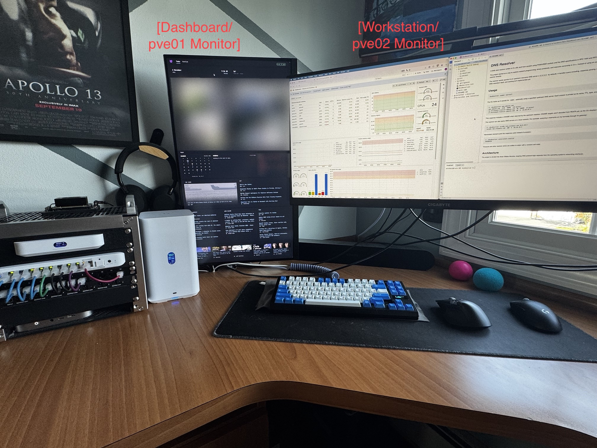
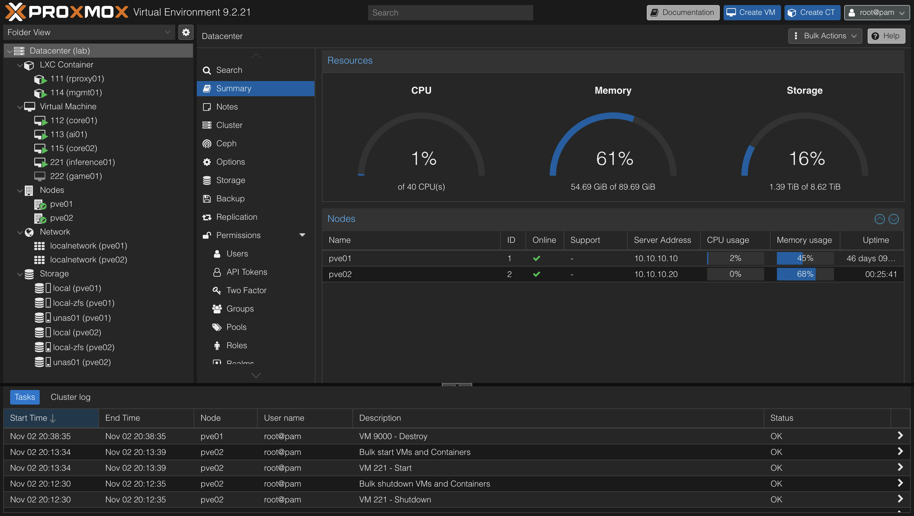
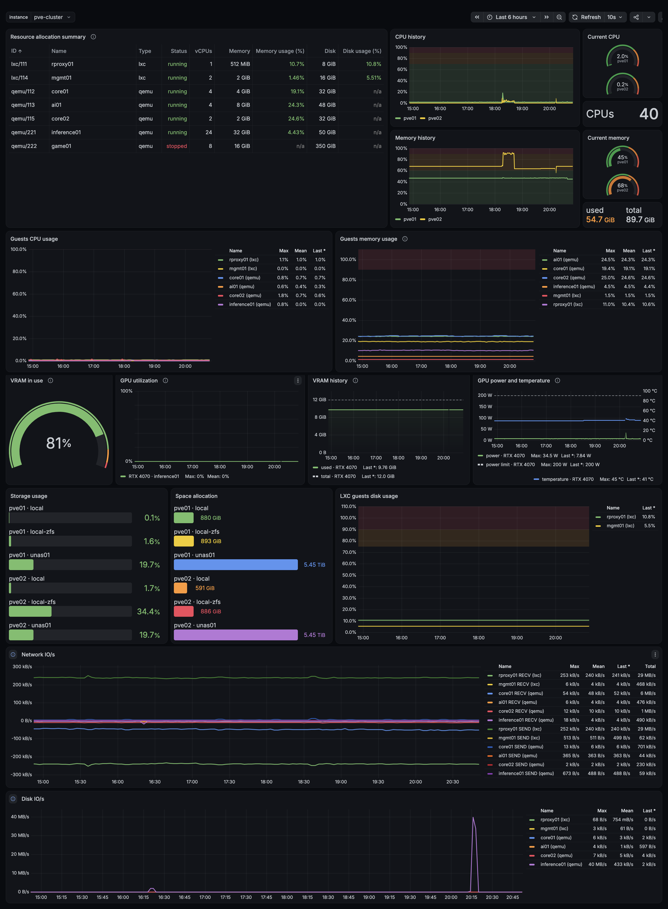
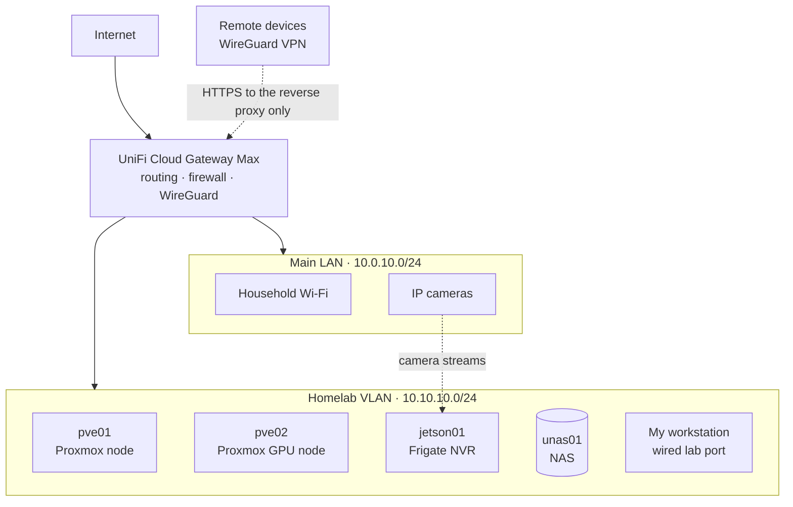
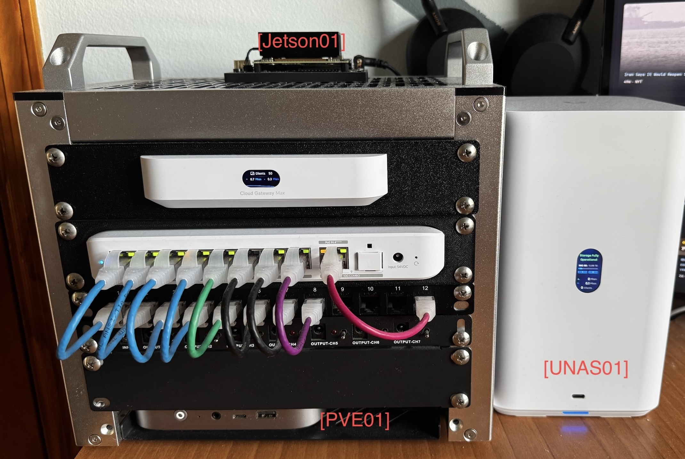
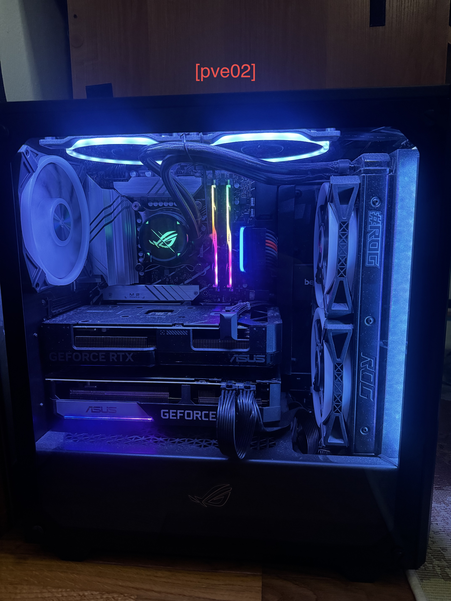

# Homelab

A two-node Proxmox lab I built to learn infrastructure operations hands-on:
provisioning, configuration management, networking, monitoring and backups,
on hardware I use every day.

It also runs workloads I actually depend on: Frigate for my security cameras, an
inference server running a local LLM, and a gaming VM with GPU passthrough.

<p align="center">
  
  <br>
  <sub>Left to right: the mini rack, unas01, the dashboard monitor driven by pve01, and the main monitor, which switches between my workstation and pve02's console.</sub>
</p>

## Foundation

| Area | What it does |
|---|---|
| **Compute** | Two-node Proxmox VE cluster on ZFS. pve01 is always on; pve02 holds the GPUs and can be powered off while the cluster stays up. Both GPUs are passed through to VMs. |
| **Network** | Lab segmented onto its own VLAN and firewall zone, WireGuard for remote access, and a Caddy reverse proxy serving internal services over HTTPS. |
| **Automation** | Ansible runs from mgmt01 and manages 8 hosts: baseline configuration (SSH keys, packages, time), rolling updates and monitoring agents, with secrets in Ansible Vault. |
| **Monitoring** | A Grafana Alloy collector gathers host, Proxmox and GPU metrics plus HTTPS checks and ships them to Grafana Cloud. Alert rules notify my phone. |
| **Backups** | Weekly Proxmox backups to the NAS over NFS, with a notification on success or failure. A restore has been tested by booting a backup as a new VM. |

<p align="center">
  
  <br>
  <sub>The cluster in Proxmox: both nodes, the guests listed below, and the NAS mounted as backup storage on each node.</sub>
</p>

<p align="center">
  
  <br>
  <sub>Proxmox and GPU metrics in Grafana Cloud (click to enlarge). The dashboard started from a community Proxmox dashboard; I added per-node labels, memory measured inside each VM, and a GPU section fed by nvidia_gpu_exporter. inference01 uses about 4% of its system RAM and 81% of the 4070's VRAM: the model lives on the GPU.</sub>
</p>

## Network



The network has two segments behind a UniFi gateway, with the ISP's router in bypass mode.

- **Main LAN:** household devices, Wi-Fi and the cameras.
- **Homelab VLAN:** both Proxmox nodes and their guests, the Jetson, the NAS, and my
  workstation on a dedicated switch port. The lab has its own firewall zone, so household
  devices can't reach it by default. Two narrow exceptions are allowed: Frigate pulls the
  camera streams from the main LAN, and my laptop can reach the lab over Wi-Fi.
- **Remote access:** a WireGuard server on the gateway, reached through dynamic DNS since the
  home IP isn't static. VPN clients are allowed only to the reverse proxy over HTTPS.
- **Names and TLS:** one wildcard record in Cloudflare points `*.lab.alecmucz.com` at the
  reverse proxy's private address, so every service gets a name without its own DNS entry.
  Caddy serves them all over HTTPS with a Let's Encrypt wildcard certificate obtained
  through a Cloudflare DNS-01 challenge, so no port is opened for validation and nothing
  is exposed to the internet.

### What runs where

| Host | Type | Runs on | Role |
|---|---|---|---|
| rproxy01 | LXC | pve01 | Caddy reverse proxy and TLS for lab services |
| mgmt01 | LXC | pve01 | Control node for Ansible and Terraform |
| core01 | VM | pve01 | Docker host for Dynacat, the dashboard on the portrait monitor |
| core02 | VM | pve01 | Docker host for the Grafana Alloy collector |
| ai01 | VM | pve01 | Open WebUI and the LiteLLM gateway |
| inference01 | VM | pve02 | llama.cpp on a passed-through RTX 4070 |
| game01 | VM | pve02 | Gaming VM on a passed-through RTX 3070 |
| jetson01 | Bare metal | — | Frigate NVR for the home cameras, and go2rtc restreams for the dashboard |

## Hardware

Most of the lab sits in a 10-inch mini rack on my desk: the UniFi gateway, a 2.5GbE
PoE switch, pve01 and the Jetson, with the NAS beside it. pve02 is a desktop tower
under the desk, and a portrait monitor attached to pve01 shows a dashboard of the lab
and my day.

| Device | Hardware | Role |
|---|---|---|
| pve01 | Beelink SER8 · Ryzen 7 8845HS · 32 GB · 2× 1 TB NVMe in a ZFS mirror | Always-on Proxmox node; hosts the core services |
| pve02 | Desktop tower · i7-13700K · 64 GB · 1 TB NVMe (ZFS) · RTX 4070 12 GB · RTX 3070 8 GB | Proxmox GPU node; can be powered off while the cluster stays up |
| jetson01 | NVIDIA Jetson Orin Nano Super 8 GB · NVMe | Camera NVR (Frigate) |
| unas01 | UniFi UNAS 2 · 2× 6 TB WD drives, mirrored (6 TB usable) | Backup target for Proxmox |
| ucg01 | UniFi Cloud Gateway Max | Routing, firewall, VLANs, WireGuard |
| usw01 | 2.5GbE PoE switch | Wired connections for the lab |


<table>
  <tr>
    <td></td>
    <td></td>
  </tr>
  <tr>
    <td><sub>Top to bottom: jetson01, the gateway (ucg01), the switch (usw01), the patch panel and pve01, with unas01 beside the rack.</sub></td>
    <td><sub>pve02, the GPU node. The RTX 4070 is passed through to inference01 and the RTX 3070 to game01.</sub></td>
  </tr>
</table>

## Repository contents

```text
.
├── ansible.cfg
├── examples/
│   └── vault.yml.example   # shape of the vaulted secrets; the real vault stays out of the repo
├── inventory/
│   ├── hosts.yml           # the 8 managed hosts and their groups
│   └── group_vars/
├── playbooks/
│   ├── baseline.yml        # SSH keys and key-only login, packages, time
│   ├── update.yml          # rolling updates
│   ├── monitoring.yml      # monitoring agents
│   └── templates/
├── roles/
│   └── baseline/
└── terraform/
    └── proxmox/            # provisioned a test VM from a cloud-init template
```